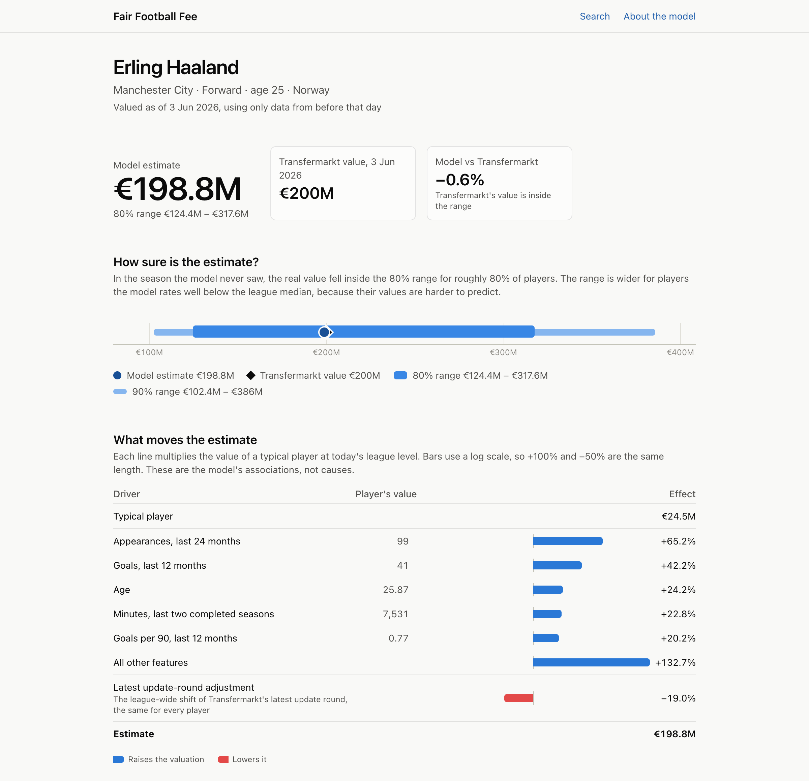
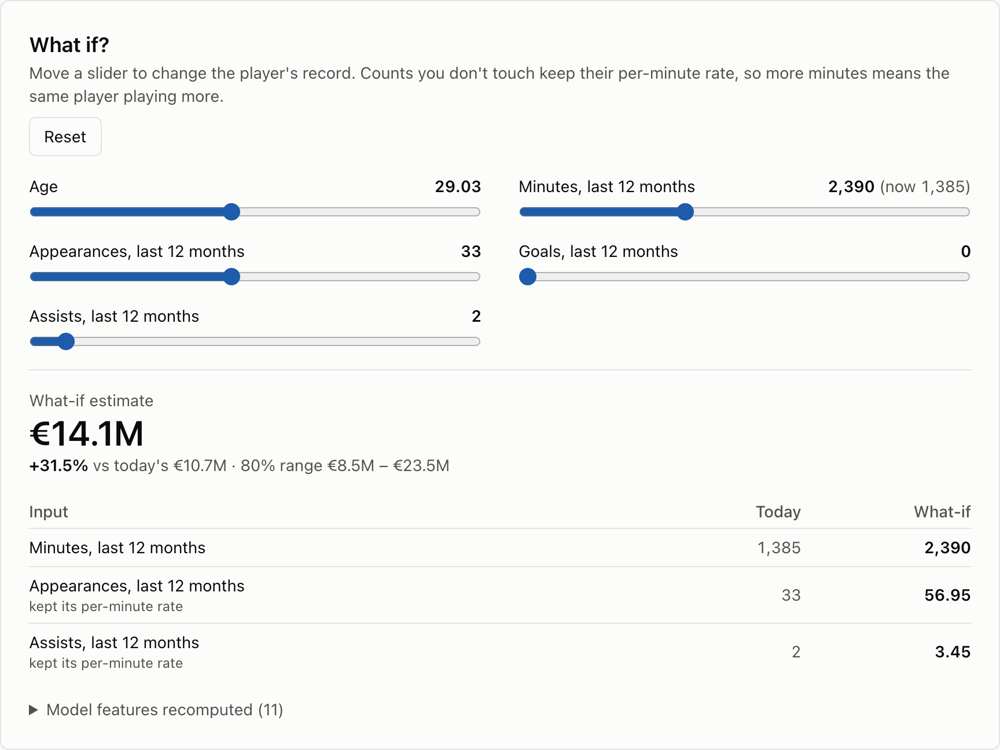
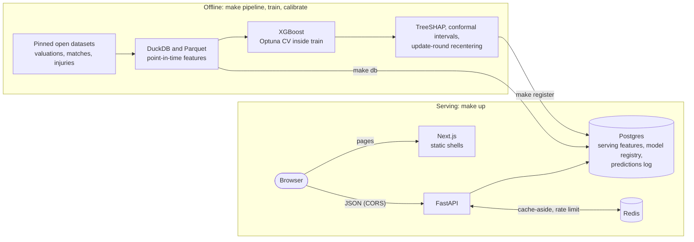

# Fair Football Fee — Player Market Value Predictor

Estimates a Premier League player's crowd-sourced market valuation (`market_value_eur`) at a date $t$ from point-in-time performance statistics, injury burden and club/league context, using only data dated before $t$. Each estimate comes with a prediction interval, the SHAP drivers behind it and what-if scenarios. The stack is an XGBoost model, a FastAPI service with a Redis cache and a Next.js UI, packaged as Docker images and checked by GitHub Actions.

> **Important Target Limitation**: The target variable (`market_value_eur`) is a **Transfermarkt crowd-sourced market valuation**, **not** an actual club-to-club negotiated transfer fee. Real transfer fees are heavily influenced by release clauses, buyer/seller financial leverage, amortization accounting, add-on clauses, and transfer-window urgency.



## Highlights

- **Honest evaluation.** Every feature is point-in-time, and tests check it: truncation invariance and train/serve parity. Splits are whole seasons, hyperparameters and model choices come from cross-validation inside the training years, and the 2025/26 test season was scored once. On that season the served estimate's median absolute error is 26.6%. Most of the gain over the best baseline (35.1%) comes from recentering on Transfermarkt's latest update round, which would help any model: the model alone scores 33.4%, statistically tied with Ridge ([model card](reports/model_card_v1.0.0.md)).
- **Calibrated uncertainty.** Split-conformal intervals, one per quartile of predicted value, are calibrated on a held-out season. The 80% interval covered 77.0% of test valuations (95% CI 73.7–80.1%).
- **Explanations a reader can check.** Exact TreeSHAP per prediction, shown as "× vs a typical player" factors that multiply back to the estimate.
- **A service that slows down instead of failing.** In the latest [load test](reports/phase7_load_test.md) on a laptop, cached valuations had a p95 of 48.0 ms at 200 requests/s. With Redis stopped at the same load, the API served 78 of 260 requests/s, turned the rest away at once with 503 "busy", and returned no errors.
- **Contracts checked in CI.** The OpenAPI schema is committed, and the UI's TypeScript types are generated from it. CI fails if either drifts from the code, if the migrations stop matching the models, or if the images stop building.



## Architecture



- **The model is data, not code.** The API image holds code and serving libraries only. The active model version is read from `model_versions` every minute and loaded from the read-only `artifacts/` mount, so registering a new model needs no new image.
- **The browser calls the API directly,** because the what-if rate limit is per client IP. Behind a reverse proxy, set `FORWARDED_ALLOW_IPS` to its address, so uvicorn takes the client from `X-Forwarded-For` only when a trusted proxy sent it.
- **Redis is an optimization, never a dependency.** Any Redis error degrades to an uncached answer (`X-Cache: BYPASS`), and a circuit breaker stops retrying for 30 s.
- **Bounded work.** Each worker takes at most 16 requests at once and waits at most 2 s for a database connection. Past that, the API answers 503 "busy" with `Retry-After` straight away instead of letting a queue grow, and requests give their database connection back before the model runs.

The reasons behind every choice are in [`docs/PROJECT_LOG.md`](docs/PROJECT_LOG.md).

## Scope

The model covers **Premier League players with at least 450 tracked minutes in the prior 12 months**. That restriction removes a 2023 change in which players the open source covers, and keeps training, evaluation and serving on the same population. Liga Pro Ecuador was evaluated and dropped: the open data has almost no Ecuadorian match statistics, and its rows are a survivorship sample. See [`docs/phase2_1_population_findings.md`](docs/phase2_1_population_findings.md) for the evidence.

## Stack
- **Data & ML**: Python 3.12, DuckDB, PyArrow (Parquet Lakehouse), Pandas, Scikit-Learn, XGBoost, LightGBM, Optuna, TreeSHAP, Split Conformal Prediction
- **Backend & Caching**: FastAPI, SQLAlchemy 2.0 + Alembic, PostgreSQL 16 (6 operational serving tables), Redis 7 (cache-aside with stampede lock and graceful fallback)
- **Frontend**: Next.js 16 (App Router), React 19, Tailwind 4, SWR; TypeScript types generated from the API's OpenAPI schema
- **Delivery**: Docker images for the API and the UI, Docker Compose, GitHub Actions CI, k6 load tests

## Reports
- [Phase 3 evaluation](reports/phase3_evaluation.md): baselines, tuned XGBoost, error slices, secondary experiments.
- [Phase 4 explanations and intervals](reports/phase4_explain_intervals.md): TreeSHAP drivers, update-round recentering, conformal prediction intervals and their coverage.
- [Model card for v1.0.0](reports/model_card_v1.0.0.md): intended use, data, performance, limitations.
- [Phase 7 load test](reports/phase7_load_test.md): latency with and without Redis, and behaviour under overload.
- Decision history and the reasons behind each choice: [`docs/PROJECT_LOG.md`](docs/PROJECT_LOG.md).

## Run it locally

Needs Python 3.12, Docker Desktop, Node 20+ and, on macOS, `brew install libomp` (`make doctor` checks the native libraries and Docker).

```bash
python3.12 -m venv .venv && .venv/bin/pip install -c constraints.txt -e ".[ml,dev]"
npm --prefix frontend ci
make pipeline    # download pinned sources → clean → point-in-time features
make train       # Phase 3 model (reuses the committed tuning)
make calibrate   # Phase 4 intervals, recentering, report + model card
make db          # Postgres + Redis in Docker, migrations, serving tables
make register    # mark the model active in model_versions
make api         # http://localhost:8000/docs
make web         # the UI on http://localhost:3000
```

Or, after `make db` and `make register`, run the API and the UI as containers with `make up` (stop them with `make down`). `make loadtest` measures the API container with k6 and rewrites the load test report.

The UI has player search, a valuation page (estimate vs the Transfermarkt value, its prediction interval and the SHAP drivers behind it) and a what-if panel.

| Endpoint | What it returns |
|---|---|
| `GET /v1/players?q=haaland` | Players matching a name, with `has_valuation` |
| `GET /v1/players/{id}/valuation` | Estimate, 80% and 90% intervals, Transfermarkt value, top SHAP drivers |
| `POST /v1/valuations` | The same for a what-if scenario, plus the change vs today |
| `GET /v1/model` | Active model, interval method, test metrics |
| `GET /v1/health` | Database, Redis and model status |

Valuations are cached in Redis (`X-Cache: HIT/MISS/BYPASS`); if Redis is down the API keeps answering, uncached. Errors use one shape, `{"detail": {"code", "message"}}`; a 503 with `"code": "busy"` and `Retry-After` means the API is at capacity.

## Checks

GitHub Actions (`.github/workflows/ci.yml`) runs on every pull request:

| Job | What it checks |
|---|---|
| Python | `ruff`, Alembic migrations on an empty Postgres plus `alembic check`, and the unit tests (`make test-unit`) |
| API contract | `make api-types` regenerates `frontend/openapi.json` and the TypeScript types, which must match the committed ones |
| Frontend | `make web-check`: type-check, lint, vitest, production build |
| Docker | both images build; the API image loads XGBoost and starts without a database, reporting it instead of crashing |

Tests that need the data lakehouse (`data`) or the loaded database (`db`) run locally with `make test`. CI and the API image install the exact library versions in `constraints.txt`, the ones the model was trained and tested with.
