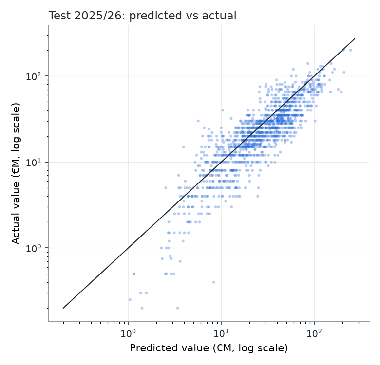
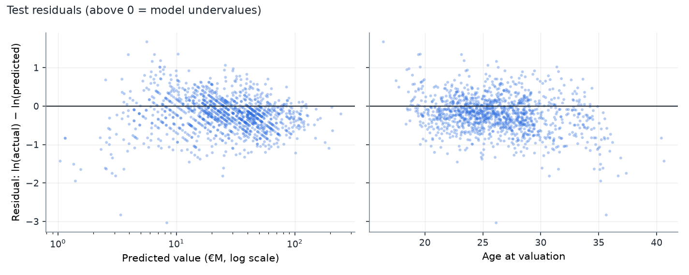
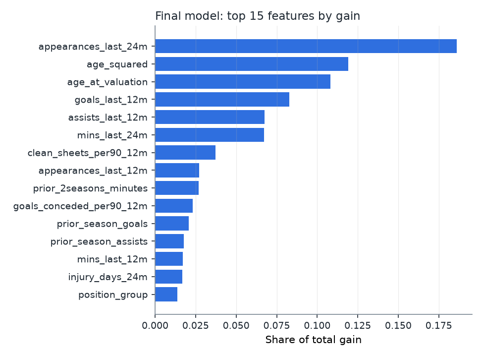

# Phase 3 Evaluation — model `v1.0.0`

_Generated by `python -m src.ml.train`. Every number below comes from `artifacts/v1.0.0/metrics.json`._

## Headline

On the held-out 2025/26 test season (1288 Premier League valuations), the tuned XGBoost model has a **median absolute percentage error of 33.4%**, and 39.9% of predictions fall within ±25% of the Transfermarkt value. The strongest baseline (Ridge (linear)) reaches 35.1%. The difference is -1.6 pts (95% CI -5.2 to +1.0, 480 players).

## Protocol

- Population (Phase 2.1): train 8,401 · val_tune 1,118 · val_calib 1,101 · test 1,288 rows.
- Tuning: 80 Optuna trials, scored by expanding-window CV inside train (validation cycles 2020/2021, 2021/2022, 2022/2023); CV RMSE 0.529 on the target scale.
- Stage A: every model is fit on train and compared on val_tune. Stage B: every model is refit on train + val_tune and scored once on test. val_calib is scored too, but it is reserved for Phase 4 calibration.
- Predictions are `expm1(prediction + ln(1 + league index))`, a median-type estimate, so MdAPE is the headline metric. No smearing correction is applied, on purpose.

## Stage A: model selection on val_tune (2023/24)

| Model | MdAPE | Within ±25% | log-RMSE | R² (log) | MAE | Mean log bias |
|---|---|---|---|---|---|---|
| Median by position + age band | 53.4% | 23.0% | 0.912 | 0.311 | €14.81M | -0.151 |
| Ridge (linear) | 28.2% | 45.9% | 0.523 | 0.774 | €8.06M | -0.030 |
| LightGBM (default) | 30.0% | 41.7% | 0.527 | 0.770 | €8.25M | -0.067 |
| XGBoost (default) | 30.1% | 43.0% | 0.530 | 0.767 | €8.08M | -0.057 |
| XGBoost (tuned) — final | 29.4% | 43.2% | 0.525 | 0.771 | €8.09M | -0.064 |

Shuffled-target sanity check (tuned XGBoost trained on a permuted target): MdAPE 55.4%, which is no better than the rule-of-thumb baseline (53.4%). This is expected, and shows there's no leak path around the target.

### Model choice

On val_tune, tuned XGBoost vs Ridge (linear): MdAPE difference +1.3 pts (95% CI -1.0 to +3.7, 484 players). The models are statistically tied at selection time. XGBoost is kept as the main model because it handles missing values natively (injury features are NULL outside the injury source), captures interactions such as age × minutes without hand-crafted terms, and gives exact per-prediction TreeSHAP attributions for the API and the what-if UI. Ridge stays in the report as the interpretable reference.

## Stage B: final evaluation

### Test (2025/26)

| Model | MdAPE | Within ±25% | log-RMSE | R² (log) | MAE | Mean log bias |
|---|---|---|---|---|---|---|
| Median by position + age band | 44.7% | 29.5% | 0.759 | 0.351 | €14.33M | -0.184 |
| Ridge (linear) | 35.1% | 37.4% | 0.534 | 0.679 | €11.94M | -0.232 |
| LightGBM (default) | 34.7% | 37.5% | 0.526 | 0.689 | €11.19M | -0.211 |
| XGBoost (default) | 32.8% | 39.7% | 0.521 | 0.694 | €10.91M | -0.215 |
| XGBoost (tuned) — final | 33.4% | 39.9% | 0.518 | 0.698 | €10.97M | -0.218 |

### val_calib (2024/25, reserved for Phase 4 calibration)

| Model | MdAPE | Within ±25% | log-RMSE | R² (log) | MAE | Mean log bias |
|---|---|---|---|---|---|---|
| Median by position + age band | 43.8% | 29.3% | 0.770 | 0.364 | €13.54M | -0.058 |
| Ridge (linear) | 27.0% | 47.0% | 0.463 | 0.770 | €8.46M | -0.048 |
| LightGBM (default) | 25.8% | 48.2% | 0.436 | 0.796 | €8.25M | -0.068 |
| XGBoost (default) | 27.8% | 45.2% | 0.442 | 0.791 | €8.20M | -0.071 |
| XGBoost (tuned) — final | 27.9% | 45.8% | 0.437 | 0.795 | €8.27M | -0.074 |

### Bias across seasons (final configuration)

| Split | Mean log bias (ln actual − ln predicted) |
|---|---|
| val_tune (stage A) | -0.064 |
| val_calib (stage B) | -0.074 |
| test (stage B) | -0.218 |

### Bias by valuation batch (months with ≥ 20 valuations; val_tune is stage A, the others stage B)

| Split | Month | n | Mean log bias |
|---|---|---|---|
| val_tune | 2023-10 | 118 | +0.043 |
| val_tune | 2023-12 | 437 | -0.192 |
| val_tune | 2024-03 | 124 | +0.118 |
| val_tune | 2024-05 | 434 | -0.020 |
| val_calib | 2024-10 | 94 | +0.052 |
| val_calib | 2024-12 | 409 | -0.017 |
| val_calib | 2025-03 | 174 | -0.019 |
| val_calib | 2025-05 | 412 | -0.189 |
| test | 2025-10 | 213 | -0.108 |
| test | 2025-12 | 436 | -0.191 |
| test | 2026-03 | 200 | -0.173 |
| test | 2026-06 | 439 | -0.318 |

### Candidate features for the out-of-time bias (train-only expanding-window CV, folds 2017/2018–2022/2023)

| Feature set | Mean CV RMSE (target scale) | Mean CV bias |
|---|---|---|
| main | 0.5305 | -0.106 |
| main + days_into_season | 0.5323 | -0.122 |
| main + index_growth_365d | 0.5513 | -0.152 |

## Error slices on test (final model)

### By actual value

| Slice | n | MdAPE | Within ±25% | Mean log bias |
|---|---|---|---|---|
| <5M | 83 | 131.4% | 12.0% | -0.878 |
| 5-15M | 248 | 41.7% | 32.7% | -0.305 |
| 15-40M | 659 | 33.4% | 40.2% | -0.175 |
| 40-80M | 243 | 24.2% | 52.3% | -0.074 |
| 80M+ | 55 | 21.6% | 56.4% | +0.032 |

### By position

| Slice | n | MdAPE | Within ±25% | Mean log bias |
|---|---|---|---|---|
| GK | 101 | 40.9% | 29.7% | -0.372 |
| DEF | 439 | 32.3% | 41.5% | -0.175 |
| MID | 382 | 34.4% | 38.7% | -0.248 |
| FWD | 366 | 32.6% | 42.1% | -0.194 |

### By age

| Slice | n | MdAPE | Within ±25% | Mean log bias |
|---|---|---|---|---|
| <21 | 100 | 31.5% | 40.0% | -0.019 |
| 21-24 | 427 | 26.7% | 46.6% | -0.182 |
| 25-28 | 508 | 33.3% | 40.4% | -0.195 |
| 29-31 | 147 | 50.4% | 29.9% | -0.323 |
| 32+ | 106 | 62.3% | 24.5% | -0.515 |

### Largest error patterns (slices with n ≥ 50, highest MdAPE)

| Dimension | Slice | n | MdAPE | Mean log bias |
|---|---|---|---|---|
| value_bucket | <5M | 83 | 131.4% | -0.878 |
| age_band | 32+ | 106 | 62.3% | -0.515 |
| age_band | 29-31 | 147 | 50.4% | -0.323 |

## Feature importance

No single feature exceeds 40% of total gain, so there's no sign of a leaking feature.

## Secondary experiments

### Value-update model vs carry-forward (1288 test rows with a previous valuation)

| Model | MdAPE | Within ±25% | log-RMSE | R² (log) | MAE | Mean log bias |
|---|---|---|---|---|---|---|
| Carry last value forward | 14.3% | 83.6% | 0.291 | 0.904 | €3.73M | +0.006 |
| XGBoost + previous value | 11.0% | 84.7% | 0.191 | 0.959 | €3.22M | -0.057 |
| XGBoost (tuned) — final | 33.4% | 39.9% | 0.518 | 0.698 | €10.97M | -0.218 |

Value-update minus carry-forward MdAPE: -3.3 pts (95% CI -4.1 to -2.2, 480 players).

### Contract-length ablation

Trained on the 611 train + val_tune rows with a point-in-time-valid contract, and scored on the 201 test rows that have one.

| Model | MdAPE | Within ±25% | log-RMSE | R² (log) | MAE | Mean log bias |
|---|---|---|---|---|---|---|
| Subset model + contract years | 32.3% | 39.3% | 0.506 | 0.530 | €11.57M | -0.101 |
| Subset model, no contract | 31.6% | 39.8% | 0.509 | 0.526 | €11.75M | -0.133 |
| XGBoost (tuned) — final | 30.2% | 44.8% | 0.493 | 0.553 | €11.54M | -0.106 |

With minus without contract (MdAPE): +0.7 pts (95% CI -2.7 to +3.9, 201 players).

## Interpretation

_Hand-written; refers to the tables above instead of repeating numbers, so it stays true when the report is regenerated._

**What the main model is.** It estimates what a player's recent playing record, output, age and fitness imply about their market value relative to the league. It deliberately doesn't know the player's previous valuation. That is why "carry the last value forward" beats it: Transfermarkt values are sticky and move in small steps. The value-update model, which does see the previous value, beats carry-forward, so the stickiness is captured where it belongs. The two models answer different questions: "what is this player's profile worth" vs "where will the next valuation land".

**Largest error patterns, and what to do about each**
1. **Low-value players (< €5M).** Large errors with strong over-prediction. Partly mechanical: slicing by *actual* value puts players who were marked down into this bucket, so the bias is partly regression to the mean. Partly real: squad players on the way out lose value in ways minutes don't capture. *Next:* contract-expiry information would help most here, but the open data can't provide it point-in-time (see the contract ablation). Phase 4 intervals should be wider here.
2. **Players aged 29+.** Over-predicted more with each age band. Transfermarkt depreciates older players faster than their recent output declines, and the model reads a 31-year-old's full season of minutes too generously. *Next:* test an age × minutes interaction or a monotone-decreasing constraint on age beyond the peak, decided by train-only CV.
3. **Valuation-batch shocks.** The bias-by-batch table shows that each Transfermarkt update round carries its own league-wide shift, from slightly positive to strongly negative. The latest test batches are the most over-predicted. This is not a clean seasonal pattern: some December batches are as negative as some May batches. A trailing-median index lags these corrections. A season-phase feature and an index-growth feature were both tested and **rejected by train-only CV**. The test split looked better with the season-phase feature, but adopting it on that basis would be test-set snooping. *Next (Phase 4):* evaluate recentering predictions by the median residual of the most recent completed batch (point-in-time valid at serving time), and check conformal coverage per batch rather than only overall.

**Contract length.** Players whose contract can be dated point-in-time are too few, and the with/without difference is inside its confidence interval. The UI shows contract length read-only, not as a what-if slider.

**Model choice.** XGBoost and Ridge are statistically tied. XGBoost ships for missing-value handling, interactions and exact TreeSHAP. Ridge stays as the interpretable reference.
