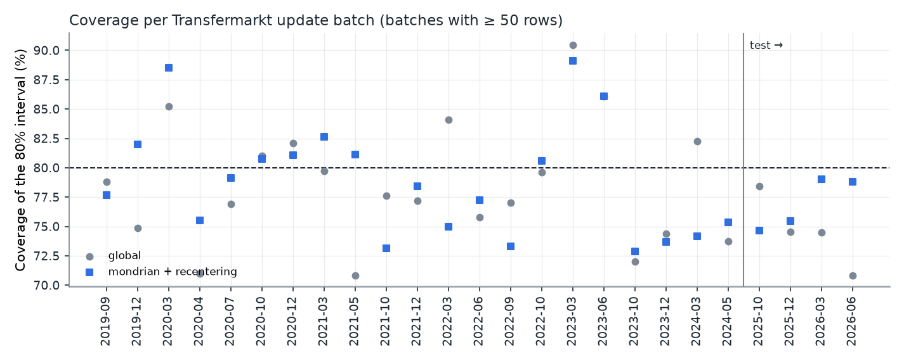
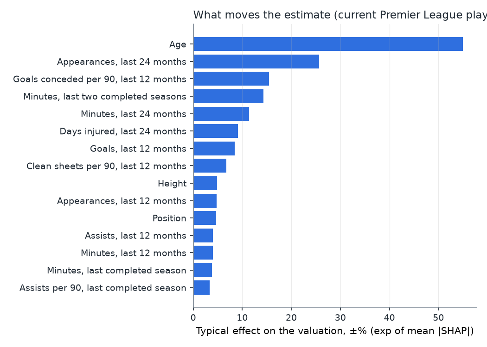
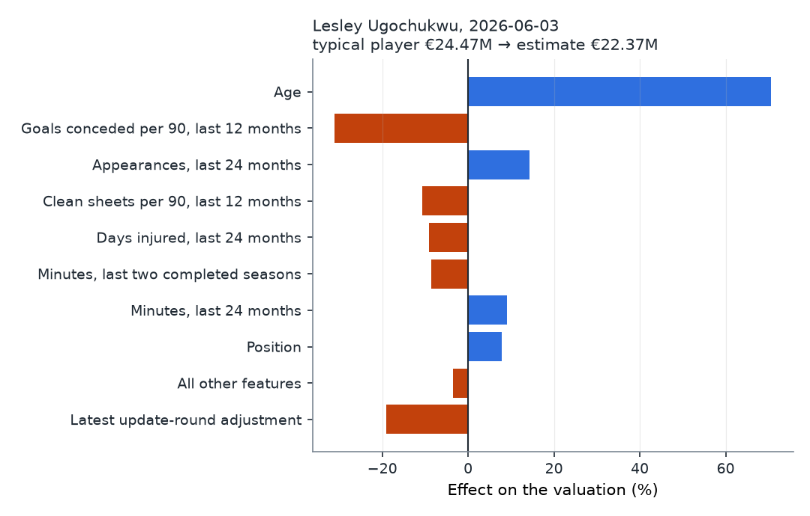

# Phase 4 — Explanations and prediction intervals, model `v1.0.0`

_Generated by `python -m src.ml.calibrate`. Every number below comes from `artifacts/v1.0.0/phase4_metrics.json` and `conformal.json`._

## Headline

On the 2025/26 test season, scored once, the served 80% intervals contain the Transfermarkt value for **77.0% (95% CI 73.7%–80.1%)** of 1288 valuations, and the 90% intervals for 88.1% (95% CI 85.6%–90.3%). A typical 80% interval is the estimate **×/÷ 1.61**. Recentering on the latest Transfermarkt update round lowers test MdAPE from 33.4% to **26.6%**, and the mean log bias from -0.218 to -0.062. Both choices (recentering and per-bin quantiles) were made on a backtest that never reads val_calib or test.

## How an interval is built

1. The model predicts r̂, the log ratio of the player's value to the league median index M.
2. **Recentering.** Transfermarkt revalues the league in update rounds. A batch is a run of valuation dates with no gap longer than 14 days. The estimate is shifted by the median residual of the most recent batch that ended before the prediction's own batch began and has at least 50 rows the model never trained on. Every row it reads is dated before the prediction.
3. **Split-conformal interval.** On val_calib, the score is |actual log ratio − recentered prediction|. Rows are split into 4 bins by the model's predicted ratio (quartiles), and each bin keeps the ⌈(n+1)·level⌉-th smallest score as its quantile q. The interval is r̂ + offset ± q, which in euros is the estimate ×/÷ e^q.

## Decision protocol: backtest inside train and val_tune

For each evaluation season E, the tuned XGBoost is fit on every cycle before E−1, calibrated on E−1 and evaluated on E. That repeats the final layout (fit on train + val_tune, calibrate on val_calib, evaluate on test) one season earlier each time. The two rules below were fixed in `src/ml/calibrate.py` before any result was seen.

| Evaluation season | Calibration season | Fit rows | Calibration rows | Evaluation rows |
|---|---|---|---|---|
| 2019/2020 | 2018/2019 | 3,133 | 854 | 888 |
| 2020/2021 | 2019/2020 | 3,987 | 888 | 1,378 |
| 2021/2022 | 2020/2021 | 4,875 | 1,378 | 985 |
| 2022/2023 | 2021/2022 | 6,253 | 985 | 1,163 |
| 2023/2024 | 2022/2023 | 7,238 | 1,163 | 1,118 |

### Rule 1: recentering

Adopt if pooled backtest MdAPE drops with a 95% CI entirely below zero. The bootstrap resamples whole batches, because every row in a batch shares one offset.

- Pooled backtest MdAPE: 34.8% without, 32.7% with recentering.
- Difference: -2.1 pts (95% CI -4.6 to -0.2, 30 batches).
- Mean |batch bias| over batches with ≥ 20 rows: 0.145 before, 0.126 after.
- **Decision: adopt** (pooled backtest MdAPE diff CI high -0.0021 < 0).

### Rule 2: one global quantile or one per predicted-value bin (Mondrian)

Use per-bin quantiles if the global interval's worst bin is more than 5 points from nominal coverage at 80% and the per-bin version's worst gap is smaller.

| Configuration | Coverage 80% | Coverage 90% | Worst bin gap (80%) | Median 80% interval | MdAPE |
|---|---|---|---|---|---|
| global | 77.5% | 88.4% | 15.6 pts | ×/÷ 1.93 | 34.8% |
| global + recentering | 78.9% | 89.2% | 12.8 pts | ×/÷ 1.92 | 32.7% |
| mondrian | 78.4% | 88.5% | 2.8 pts | ×/÷ 1.98 | 34.8% |
| mondrian + recentering ← chosen | 79.0% | 89.0% | 2.8 pts | ×/÷ 2.02 | 32.7% |

Coverage of the 80% interval per predicted-value bin (backtest):

| Configuration | Bin 1 | Bin 2 | Bin 3 | Bin 4 |
|---|---|---|---|---|
| global | 64.4% | 76.3% | 84.2% | 85.2% |
| global + recentering | 67.2% | 76.2% | 83.6% | 88.7% |
| mondrian | 77.2% | 77.9% | 79.9% | 78.8% |
| mondrian + recentering | 77.2% | 78.8% | 79.2% | 81.0% |

- **Decision: per-bin (Mondrian)** (global worst-bin gap 0.128 vs trigger 0.05, Mondrian worst-bin gap 0.028).
- Configuration served: **mondrian + recentering**.

## Final calibration on val_calib

The saved model (trained on train + val_tune) reproduces the Phase 3 predictions (max relative difference 2.2e-16). Calibrated on 1,101 val_calib rows:

| Bin (model's estimate vs league median) | Calibration rows | 80% interval | 90% interval |
|---|---|---|---|
| below 0.59 × median | 275 | ×/÷ 2.01 | ×/÷ 2.55 |
| 0.59–1.13 × median | 275 | ×/÷ 1.66 | ×/÷ 1.87 |
| 1.13–1.84 × median | 275 | ×/÷ 1.61 | ×/÷ 1.93 |
| above 1.84 × median | 276 | ×/÷ 1.60 | ×/÷ 1.94 |

## Test evaluation (2025/26, scored once)

### Coverage

- 80% interval: 77.0% (95% CI 73.7%–80.1%), median width ×/÷ 1.61.
- 90% interval: 88.1% (95% CI 85.6%–90.3%), median width ×/÷ 1.94.

| Update batch | n | Coverage 80% | Coverage 90% |
|---|---|---|---|
| 2025-10-17 | 213 | 74.6% | 86.4% |
| 2025-12-09 | 436 | 75.5% | 86.0% |
| 2026-03-09 | 200 | 79.0% | 91.5% |
| 2026-06-03 | 439 | 78.8% | 89.5% |

| Predicted-value bin | n | Coverage 80% | Coverage 90% |
|---|---|---|---|
| Bin 1: below 0.59 × median | 283 | 73.1% | 85.9% |
| Bin 2: 0.59–1.13 × median | 330 | 80.9% | 88.2% |
| Bin 3: 1.13–1.84 × median | 295 | 76.9% | 87.1% |
| Bin 4: above 1.84 × median | 380 | 76.6% | 90.5% |

| Position | n | Coverage 80% | Coverage 90% |
|---|---|---|---|
| DEF | 439 | 79.3% | 88.2% |
| FWD | 366 | 77.0% | 89.1% |
| GK | 101 | 69.3% | 88.1% |
| MID | 382 | 76.4% | 87.2% |

By actual value (for information only: no method can guarantee coverage conditional on the true value, because it isn't known when the interval is made):

| Actual value | n | Coverage 80% | Coverage 90% |
|---|---|---|---|
| <5M | 83 | 53.0% | 69.9% |
| 5-15M | 248 | 77.8% | 85.9% |
| 15-40M | 659 | 78.9% | 90.3% |
| 40-80M | 243 | 78.6% | 91.8% |
| 80M+ | 55 | 80.0% | 83.6% |

### Point accuracy with and without recentering

| Model | MdAPE | Within ±25% | log-RMSE | R² (log) | MAE | Mean log bias |
|---|---|---|---|---|---|---|
| XGBoost v1.0.0 (Phase 3) | 33.4% | 39.9% | 0.518 | 0.698 | €10.97M | -0.218 |
| XGBoost v1.0.0 + recentering (served) | 26.6% | 47.5% | 0.472 | 0.749 | €8.77M | -0.062 |

| Batch | n | Offset | Mean log bias before | Mean log bias after |
|---|---|---|---|---|
| 2025-10-17 | 213 | -0.177 | -0.108 | +0.069 |
| 2025-12-09 | 436 | -0.085 | -0.191 | -0.105 |
| 2026-03-09 | 200 | -0.163 | -0.173 | -0.010 |
| 2026-06-03 | 439 | -0.211 | -0.318 | -0.107 |

Test has only four batches, so the evidence for recentering is the backtest CI above, not this table. Every configuration was scored on test after the decision, for the record:

| Configuration | Coverage 80% | Coverage 90% | Worst bin gap (80%) | Median 80% interval | MdAPE |
|---|---|---|---|---|---|
| global | 73.9% | 84.8% | 19.2 pts | ×/÷ 1.73 | 33.4% |
| global + recentering | 77.6% | 87.4% | 17.8 pts | ×/÷ 1.72 | 26.6% |
| mondrian | 73.5% | 85.2% | 10.7 pts | ×/÷ 1.66 | 33.4% |
| mondrian + recentering ← chosen | 77.0% | 88.1% | 6.9 pts | ×/÷ 1.61 | 26.6% |

## Serving configuration (`conformal.json`, stored in `model_versions.conformal_quantiles`)

- Serving rows are dated 2026-06-03. Their offset is -0.211 (×0.810), the median residual of the 2026-03-09 batch (200 rows).
- Parity: all 439 of 439 serving players match their test row on the same date (max prediction difference 0.0e+00, same offset: True).
- Median 80% interval for serving players: ×/÷ 1.66.
- The offset depends on the data: rerun `make calibrate` after every data refresh.

## TreeSHAP explanations

XGBoost's built-in exact TreeSHAP (`pred_contribs=True`) explains each prediction. The values add up to the model output: max additivity error 3.8e-06 on test and 2.6e-06 on serving rows. `shap.TreeExplainer` gives the same values (max difference 0.0e+00 on 200 rows).

**Reading them.** SHAP values are in log-ratio units and add up: r̂ = φ₀ + Σφᵢ. In euros that becomes a product, (1 + value) = (1 + M) · e^φ₀ · Π e^φᵢ · e^offset, so each driver multiplies the valuation by e^φᵢ and is shown as e^φᵢ − 1 (for example +18%). The starting point (1 + M) · e^φ₀ − 1 is a typical player in the training population at today's league level. Age and age² are summed into one driver.

### What moves the estimate (mean |SHAP| over current players)

| Driver | Typical effect |
|---|---|
| Age | ±55.0% |
| Appearances, last 24 months | ±25.7% |
| Goals conceded per 90, last 12 months | ±15.4% |
| Minutes, last two completed seasons | ±14.3% |
| Minutes, last 24 months | ±11.4% |
| Days injured, last 24 months | ±9.1% |
| Goals, last 12 months | ±8.4% |
| Clean sheets per 90, last 12 months | ±6.8% |
| Height | ±4.9% |
| Appearances, last 12 months | ±4.8% |
| Position | ±4.7% |
| Assists, last 12 months | ±4.0% |

### Worked example

Lesley Ugochukwu on 2026-06-03 (the current player whose estimate is closest to the median). League median index €25.00M; a typical player is worth €24.47M.

| Driver | Value | Effect |
|---|---|---|
| Age | 22.19 | +70.6% |
| Goals conceded per 90, last 12 months | 1.989 | -31.2% |
| Appearances, last 24 months | 67.0 | +14.3% |
| Clean sheets per 90, last 12 months | 0.08 | -10.8% |
| Days injured, last 24 months | 0.0 | -9.2% |
| Minutes, last two completed seasons | 2173.0 | -8.6% |
| Minutes, last 24 months | 4370.0 | +9.1% |
| Position | MID | +7.9% |
| Latest update-round adjustment | — | -19.0% |

Estimate: **€22.37M**, 80% interval €13.47M–€37.15M.

## Interpretation

_Hand-written; refers to the tables above instead of repeating numbers, so it stays true when the report is regenerated._

**What recentering does.** The model predicts value relative to a trailing league median, and that median lags Transfermarkt's revaluation rounds, so every player in a round inherits the same error. Recentering measures how far off the model was on the last completed round and shifts the next round by that amount. It reads only valuations published before the prediction, it moves every player in a round by the same factor (so rankings and SHAP drivers don't change), and it was adopted because its backtest improvement has a confidence interval below zero, not because test looked good. A correction shared by a whole round can't be judged on one season of four rounds, which is why the decision uses five backtest seasons.

**Why one interval width per predicted-value bin.** A single quantile averages easy and hard cases. Players the model rates well below the league median have the largest errors (Phase 3), so one global width is too narrow for them and too wide for everyone else, and the backtest per-bin table shows exactly that. Per-bin (Mondrian) quantiles give each quartile of the model's own prediction its own width. The bin comes from the prediction, which is known when the interval is made; the actual value isn't.

**Reading the test coverage.** Split-conformal guarantees coverage when calibration and test rows are exchangeable. Seasons drift, so the guarantee doesn't carry over automatically, and the claim to defend is the measured one: test coverage is slightly under nominal, its confidence interval reaches nominal, and it is fairly even across update batches and predicted-value bins. The weakest cells are goalkeepers (a small slice) and players whose actual value ended up lowest. The second is partly mechanical: grouping by the outcome selects the players the model missed, and no interval built before the outcome can fully fix that.

**Two drivers that need care in the API and UI.**
1. *Goals conceded and clean sheets per 90* mostly measure the team's defence while the player is on the pitch, so they act as a club-strength signal: players in strong teams get higher crowd valuations. That pattern is real in the target, but the player doesn't control it alone.
2. *Days injured raises the estimate.* Players with long recent injuries have fewer minutes, yet their injury contribution is the most positive. The feature tells the model why minutes are low: low minutes without an injury usually means a squad player, while low minutes with a long injury means a regular who was out. SHAP describes the model's associations, not what an injury would do to a valuation. For the what-if UI, injury days can't be a free-standing slider: changing them without changing minutes describes a player the model has rarely seen and gives a misleading answer.

**Still open.** Recentering shifts everyone in a round equally, so it doesn't fix the over-valuation of players aged 29+ (Phase 3). The planned test (an age × minutes interaction or a monotone constraint past the peak, decided by train-only CV) belongs to a v1.1 model. The offset is a property of the data rather than the model, so it must be recomputed after every data refresh, and intervals won't widen for an update round that moves the league more than any round in val_calib did.
